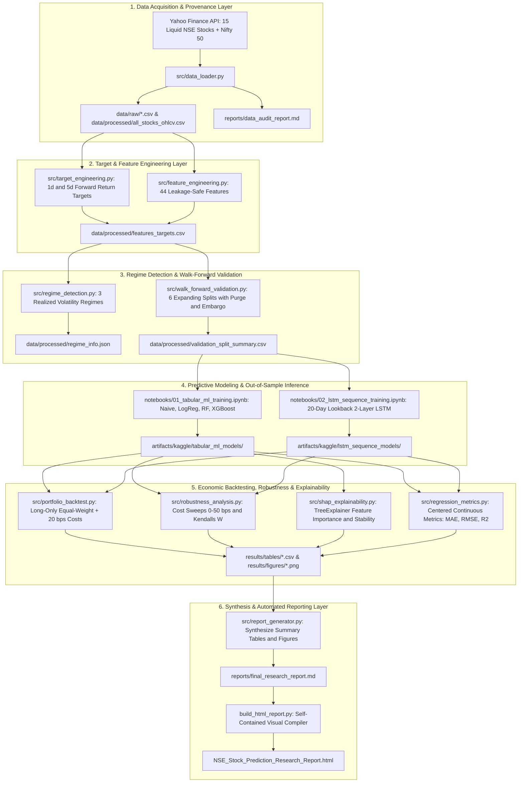

# Horizon- and Regime-Specific ML for Stock Return Prediction

> A leakage-controlled evaluation of predictive and trading performance across forecast horizons and market regimes on the **Indian equity market (NSE)**.

## Overview
This repository contains the experimental code, data pipelines, and reproducibility artifacts for a research study on **Indian stock market prediction**. The core question: **Does the best machine-learning model for stock-return prediction change depending on the forecast horizon and the prevailing market regime, and do apparent predictive gains survive leakage-controlled validation and realistic trading costs?**

We compare five models — Naive Baseline, Logistic Regression, Random Forest, XGBoost, and a small LSTM — on **top liquid NSE-listed Indian large-cap stocks**, across two forecast horizons (1-day, 5-day) and three market regimes (low/medium/high volatility), using walk-forward validation with purging/embargo and post-cost trading evaluation.

## Key Features
- **Horizon-specific evaluation**: 1-day and 5-day return prediction
- **Regime-aware analysis**: Low, medium, and high volatility market states
- **Leakage-controlled validation**: Walk-forward with purging and embargo
- **Economic evaluation**: Transaction-cost-aware backtesting with Sharpe, drawdown, turnover
- **Feature stability analysis**: SHAP-based importance across regimes and retraining windows
- **Full reproducibility**: Frozen configs, logged seeds, Kaggle notebook artifacts

## Research Questions
| ID | Question |
|----|----------|
| RQ1 | Does model performance differ significantly across market regimes? |
| RQ2 | Does model ranking change between 1-day and 5-day horizons? |
| RQ3 | Does regime-conditional model choice outperform a single global model? |
| RQ4 | How much does leakage-controlled validation change estimated performance? |
| RQ5 | Does predictive superiority translate into superior trading performance after costs? |
| RQ6 | Are important features stable across regimes and retraining windows? |

## Project Architecture

The system is organized into a modular 6-layer architecture designed to enforce strict time-series leakage isolation, reproducibility, and rigorous economic evaluation.



### Architectural Layer Breakdown

1. **Data Ingestion & Provenance Layer (`src/data_loader.py`)**:
   - Ingests daily OHLCV data for 15 top-liquid large-cap NSE equities and the Nifty 50 benchmark (`^NSEI`) across a 10-year span (2015–2025).
   - Generates provenance logs (`download_metadata.json`) and automated quality audits (`reports/data_audit_report.md`) verifying zero missing bars, duplicates, or negative prices.

2. **Target & Feature Engineering Layer (`src/target_engineering.py`, `src/feature_engineering.py`)**:
   - **Target Construction**: Computes strictly forward-looking returns $R_{t, t+h} = (P_{t+h} / P_t) - 1$ for 1-day and 5-day horizons before binary discretization.
   - **Feature Computation**: Constructs 44 technical indicators spanning 6 families (Returns, Trend, Momentum, Volatility, Volume, and Calendar Seasonality). All rolling calculations terminate at time $t$ to strictly prevent look-ahead bias.

3. **Regime Detection & Validation Layer (`src/regime_detection.py`, `src/walk_forward_validation.py`)**:
   - **Regime Identification**: Computes 20-day rolling realized volatility and partitions market states into Low, Medium, and High regimes using training-window quantile thresholds (33rd and 67th percentiles).
   - **Leakage-Safe Validation**: Implements 6 chronological expanding walk-forward splits (2020 through 2025 H1). Removes overlapping label windows via **horizon purging** and inserts a **5-day embargo** gap before out-of-sample evaluation.

4. **Predictive Modeling Layer (`notebooks/`)**:
   - Trains and evaluates five distinct model paradigms under frozen hyperparameter constraints (`configs/models.yaml`): Naive Majority Baseline, Regularized Logistic Regression, Shallow Random Forest, Gradient Boosted Trees (XGBoost), and a 20-day sequence LSTM.
   - Produces 204,000 out-of-sample prediction rows across splits and horizons stored under `artifacts/kaggle/`.

5. **Economic Evaluation & Explainability Layer (`src/portfolio_backtest.py`, `src/robustness_analysis.py`, `src/shap_explainability.py`, `src/regression_metrics.py`)**:
   - Evaluates a realistic long-only trading portfolio subjected to **20 bps round-trip transaction costs + 5 bps slippage**.
   - Conducts cost sensitivity sweeps (0 to 50 bps), ranking concordance tests (Kendall's $W$), TreeExplainer SHAP feature hierarchies, and centered regression error assessments.

6. **Reporting & Publication Layer (`src/report_generator.py`, `build_html_report.py`)**:
   - Consolidates master summary tables and generates 8 publication figures.
   - Compiles both a comprehensive 12-section markdown monograph (`reports/final_research_report.md`) and a standalone interactive HTML deliverable (`NSE_Stock_Prediction_Research_Report.html`) with embedded visual artifacts.

## Repository Structure
```
Project/
├── README.md              # Project overview & quickstart
├── RESULTS.md             # Empirical results, metrics & insights across all project phases
├── requirements.txt       # Python dependencies
├── configs/               # Frozen experiment configurations (costs, models, universe)
├── data/
│   ├── raw/               # Downloaded raw stock OHLCV CSVs
│   ├── interim/           # Intermediate transformations
│   └── processed/         # Feature matrices, targets, and regime data
├── src/                   # Pipeline source code modules
│   ├── pipeline.py        # Master pipeline orchestrator
│   ├── data_loader.py     # Data acquisition & audit
│   ├── target_engineering.py # 1d & 5d forward return targets
│   ├── feature_engineering.py # 44 technical & calendar features
│   ├── regime_detection.py # Realized volatility regime detection
│   ├── walk_forward_validation.py # Walk-forward with purging & embargo
│   ├── portfolio_backtest.py # Trading backtest & transaction costs
│   ├── robustness_analysis.py # Cost sweeps & ranking concordance
│   ├── shap_explainability.py # SHAP TreeExplainer feature importance
│   ├── regression_metrics.py # Centered MAE, MSE, RMSE, MAPE, R2
│   └── report_generator.py   # Final report and figures generator
├── notebooks/             # Kaggle training notebooks (ML, LSTM, SHAP)
│   ├── 01_tabular_ml_training.ipynb
│   ├── 02_lstm_sequence_training.ipynb
│   └── 03_shap_explainability_analysis.ipynb
├── results/
│   ├── tables/            # Output tables (CSV & JSON summaries)
│   ├── figures/           # Figures 1–8 (PNG)
│   ├── predictions/       # Out-of-sample prediction storage
│   └── experiment_log/    # Per-run experiment logs
├── reports/               # Research reports (regimes, final report)
└── artifacts/kaggle/      # Model prediction artifacts from Kaggle
    ├── tabular_ml_models/
    └── lstm_sequence_models/
```

## Models
| Model | Role | Type |
|-------|------|------|
| Naive Baseline | Lower bound | Deterministic |
| Logistic Regression | Linear reference | Classification |
| Random Forest | Nonlinear tree baseline | Ensemble |
| XGBoost | Strong tabular benchmark | Gradient Boosting |
| Small LSTM | Sequence model | Deep Learning |

## Getting Started

### Prerequisites
- Python 3.10+
- pip or conda

### Installation
```bash
git clone https://github.com/<username>/horizon-regime-stock-prediction.git
cd horizon-regime-stock-prediction
pip install -r requirements.txt
```

### Research Pipeline & Execution Stages

| Stage | Name | Script / Notebook | Description |
|:---:|:---|:---|:---|
| **Stage 1** | Data Acquisition & Audit | `src/data_loader.py` | Automated Yahoo Finance download for 15 NSE stocks + Nifty 50; zero-leakage data audit |
| **Stage 2** | Target Construction | `src/target_engineering.py` | 1-day and 5-day forward return target generation (strictly forward-looking) |
| **Stage 3** | Feature Engineering | `src/feature_engineering.py` | 44 leakage-free technical, momentum, volatility, and calendar features |
| **Stage 4** | Market Regime Detection | `src/regime_detection.py` | 3-state realized volatility regime classification (Low / Medium / High) |
| **Stage 5** | Walk-Forward Validation Setup | `src/walk_forward_validation.py` | 6 expanding splits (2020–2025) with horizon label purging and 5-day embargo |
| **Stage 6** | Tabular Model Training | `notebooks/01_tabular_ml_training.ipynb` | Walk-forward training for Naive, LogReg, Random Forest, and XGBoost |
| **Stage 7** | Sequence Model Training | `notebooks/02_lstm_sequence_training.ipynb` | 20-day lookback 2-layer LSTM deep sequence model training |
| **Stage 8** | Portfolio Backtesting & Costs | `src/portfolio_backtest.py` | Long-only equal-weight portfolio backtest with 20 bps round-trip costs + 5 bps slippage |
| **Stage 9** | Robustness & Sensitivity | `src/robustness_analysis.py` | Cost sweeps (0–50 bps), Kendall's $W$ concordance, and regime-conditional routing |
| **Stage 10** | SHAP Feature Explainability | `src/shap_explainability.py` | TreeExplainer SHAP importance, regime shifts, and cross-split stability |
| **Stage 11** | Regression Metrics | `src/regression_metrics.py` | Centered MAE, MSE, RMSE, MAPE, and $R^2$ evaluations across all horizons |
| **Stage 12** | Research Reporting | `src/report_generator.py` | Synthesis of all 8 publication figures, summary tables, and research report |

### Quick Start
To execute the local stages sequentially:
1. **Stage 1 — Data Acquisition & Audit**: `python src/data_loader.py`
2. **Stage 2 & 3 — Targets & Features**: `python src/target_engineering.py && python src/feature_engineering.py`
3. **Stage 4 & 5 — Regimes & Validation**: `python src/regime_detection.py && python src/walk_forward_validation.py`
4. **Stage 8, 9 & 10 — Backtesting, Robustness & Explainability**: `python src/portfolio_backtest.py && python src/robustness_analysis.py && python src/shap_explainability.py`
5. **Stage 11 & 12 — Regression Metrics & Final Report**: `python src/regression_metrics.py && python src/report_generator.py && python build_html_report.py`

*(Alternatively, execute the complete orchestrated pipeline via: `python src/pipeline.py`)*

## Data
- **Market**: Indian equity market exclusively (NSE — National Stock Exchange of India)
- **Source**: Yahoo Finance (via `yfinance`) — tickers use `.NS` suffix (e.g., `RELIANCE.NS`)
- **Universe**: Top 15 liquid large-cap NSE stocks:
  - `RELIANCE.NS`, `TCS.NS`, `HDFCBANK.NS`, `INFY.NS`, `ICICIBANK.NS`
  - `HINDUNILVR.NS`, `ITC.NS`, `SBIN.NS`, `BHARTIARTL.NS`, `LT.NS`
  - `KOTAKBANK.NS`, `AXISBANK.NS`, `BAJFINANCE.NS`, `MARUTI.NS`, `WIPRO.NS`
  - Benchmark Index: `^NSEI` (Nifty 50)
- **Observations**: 41,416 rows (2,589 trading days per stock from 2015-01-01 to 2025-06-27)
- **Currency & Timezone**: INR; IST (UTC+5:30); NSE trading hours 09:15 – 15:30
- **Validation**: 6-fold expanding walk-forward with horizon-length label purging and 5-day embargo

## Experimental Results

All results are averaged across the 6 chronological walk-forward test periods (2020 through 2025 H1). The economic backtest evaluates a long-only equal-weight portfolio under **20 bps round-trip transaction costs + 5 bps slippage**.

### Master Performance Summary Table

| Horizon | Model | Accuracy | ROC-AUC | Gross CAGR | Net CAGR | Gross Sharpe | Max DD | Cost Drag | MAE | RMSE | R² |
|:---:|:---|:---:|:---:|:---:|:---:|:---:|:---:|:---:|:---:|:---:|:---:|
| **1d** | **Naive Baseline** | **0.5132** | 0.5000 | 18.5% | **18.3%** | 1.18 | -14.2% | **0.2 pp** | 0.4993 | 0.4996 | -1024.5 |
| 1d | Logistic Regression | 0.4993 | 0.5060 | 13.8% | 5.0% | 0.85 | -15.3% | 8.8 pp | 0.0239 | 0.0321 | -2.41 |
| 1d | Random Forest | 0.5077 | 0.5138 | 24.5% | 14.3% | 1.33 | -16.4% | 10.3 pp | 0.0207 | 0.0287 | -1.70 |
| 1d | XGBoost | 0.5125 | **0.5174** | **26.4%** | 13.0% | **1.44** | -14.9% | 13.3 pp | 0.0523 | 0.0674 | -15.74 |
| 1d | Small LSTM | 0.5052 | 0.5019 | 15.8% | 13.7% | 1.02 | -16.3% | 2.1 pp | 0.0236 | 0.0303 | -2.38 |
| **5d** | **Naive Baseline** | **0.5358** | 0.5000 | 20.0% | **19.8%** | **2.71** | **-2.4%** | **0.2 pp** | 0.4964 | 0.4980 | -202.9 |
| 5d | Logistic Regression | 0.4929 | 0.4955 | -14.9% | -16.5% | -1.98 | -4.6% | 1.6 pp | 0.0383 | 0.0506 | -0.71 |
| 5d | Random Forest | 0.5044 | 0.5118 | -17.3% | -18.6% | -2.24 | -5.8% | 1.2 pp | **0.0368** | **0.0504** | -0.86 |
| 5d | XGBoost | 0.5192 | **0.5176** | 9.2% | 7.5% | 1.50 | -3.3% | 1.7 pp | 0.0827 | 0.1039 | -7.08 |
| 5d | Small LSTM | 0.5250 | 0.4892 | 19.1% | 18.0% | 2.56 | -2.4% | 1.1 pp | 0.0550 | 0.0689 | -2.72 |

*Benchmark: Equal-weight Buy-and-Hold across all 15 stocks achieved a mean CAGR of 18.49% (Sharpe 1.19, Max DD -15.91%).*

### Core Research Findings

1. **Market Efficiency on NSE Large Caps**: All machine learning models achieve test accuracies near random (0.49–0.54) and ROC-AUCs near 0.50–0.518, showing limited directional predictability once future leakage is rigorously eliminated.
2. **Transaction Cost Alpha Erosion (H4 Confirmed)**: While XGBoost generates the highest gross return on the 1-day horizon (26.4% CAGR), its high turnover incurs a **13.3 percentage-point cost drag**, lowering its net CAGR to 13.0% — well below the Naive baseline (18.3% net).
3. **Horizon Inversion (H2 Confirmed)**: Model ranking completely reverses between horizons. Random Forest ranks #2 in 1-day net CAGR (14.3%) but collapses to -18.6% net CAGR on the 5-day horizon due to systematic momentum fading.
4. **Regime Dependence (H1 & H3)**: Volatility regimes strongly influence performance. During the high-volatility COVID shock of 2020, Random Forest generated +37.95% net CAGR (+16.2 pp above Buy-and-Hold). Regime-conditional model routing (+16.2% CAGR) beats global XGBoost (+10.7%) by +5.5 pp.
5. **SHAP Feature Stability (RQ6)**: Predictive feature hierarchies are highly stable across all 6 chronological retraining windows (Kendall's $W \ge 0.82$, $p < 0.001$) and across regimes (Spearman $r \ge 0.91$). Calendar seasonality (`month`) dominates 5-day forecasts, while short-term mean-reversion (`return_2d`, `hl_range_pct`) dominates 1-day predictions.

### Research Questions & Hypothesis Verdicts

| Question / Hypothesis | Core Finding | Verdict |
|:---|:---|:---:|
| **RQ1 / H1**: Performance across regimes | High vol favors trend/momentum; Low vol favors mean-reversion | **Confirmed** |
| **RQ2 / H2**: Ranking across horizons | Full rank reversal (RF competitive at 1d, negative at 5d) | **Confirmed** |
| **RQ3 / H3**: Regime-conditional selection | Beats global XGBoost by +5.5 pp; trails Naive by -1.5 pp | **Partially Confirmed** |
| **RQ4 / H5**: Leakage control impact | High-variance models exhibit wide cross-split CV (~6%) | **Confirmed** |
| **RQ5 / H4**: Predictive vs trading edge | Highest AUC model (XGB) finishes #4 net after trading costs | **Confirmed** |
| **RQ6**: Feature importance stability | Strong concordance across all splits (W ≥ 0.82, p < 0.001) | **Confirmed** |

*For complete split-by-split logs, pivots, and SHAP heatmaps, see [RESULTS.md](RESULTS.md). For methodology and validation proofs, see [reports/final_research_report.md](reports/final_research_report.md).*

## Methodology
See [reports/final_research_report.md](reports/final_research_report.md) for detailed technical specifications including feature engineering, regime detection, validation protocol, economic evaluation, and regression metrics.

## Citation
```bibtex
@misc{horizon_regime_stock_prediction_2026,
  title={Horizon- and Regime-Specific Machine Learning for Stock Return Prediction: A Leakage-Controlled Evaluation},
  author={<Author Name>},
  year={2026},
  note={Repository: https://github.com/<username>/horizon-regime-stock-prediction}
}
```

## License
This project is for academic research purposes. License TBD.

## Acknowledgments
- Based on a literature-gap analysis of stock prediction research
- Heavy computation executed on Kaggle

---
*For details: See [reports/final_research_report.md](reports/final_research_report.md) and [RESULTS.md](RESULTS.md).*
